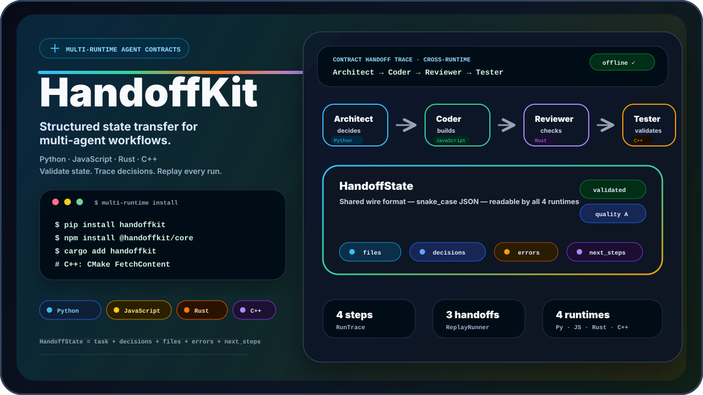
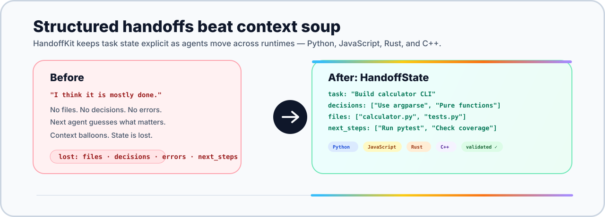
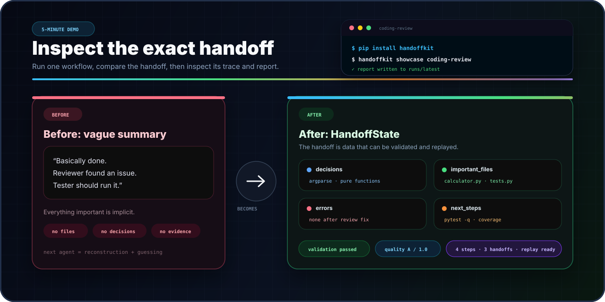
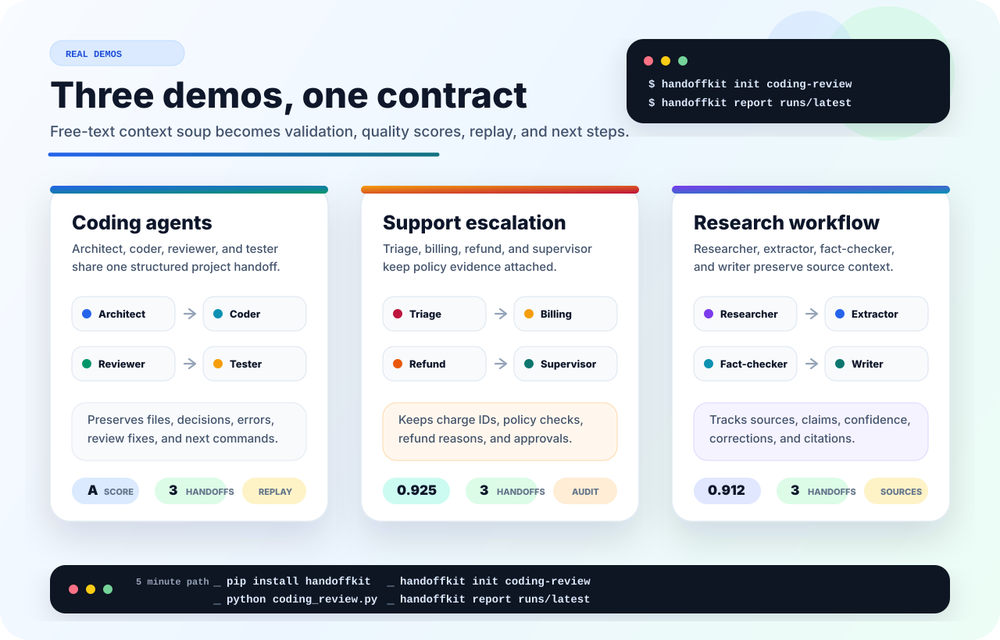
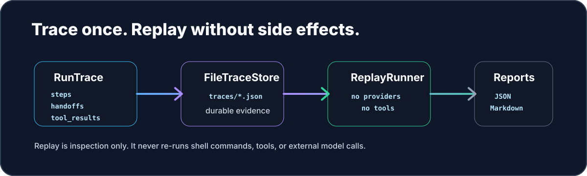
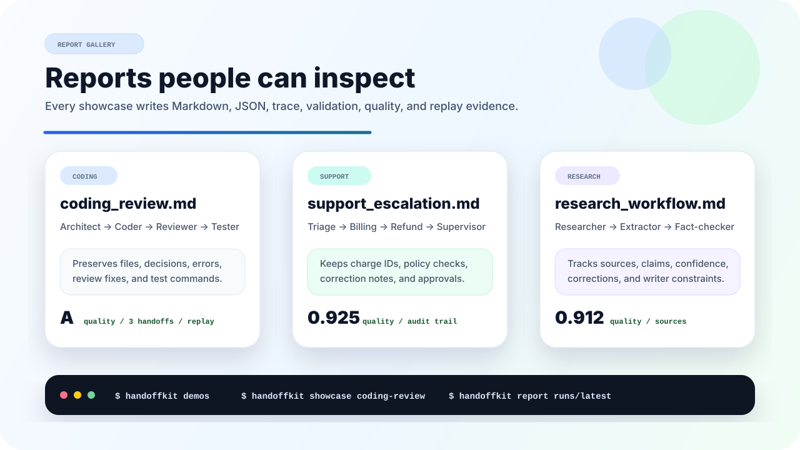

<div align="center">



# HandoffKit

**Contract-first infrastructure for multi-agent workflows.**

Move tasks, decisions, files, errors, evidence, and next steps between agents as
validated data instead of fragile chat summaries.

[](https://github.com/DaosPath/handoffkit/actions)
[](https://pypi.org/project/handoffkit/)
[](https://www.npmjs.com/package/@handoffkit/core)
[](https://crates.io/crates/handoffkit)
[](cpp/packages/handoffkit/README.md)
[](LICENSE)

[Quick start](#quick-start) · [Runtime status](#runtime-status) · [Browser 1.20](#browser-platform-120-in-development) · [Native Fusion](#native-c-fusion) · [Documentation](docs/README.md) · [Roadmap](docs/roadmap/README.md)

**Stable:** `1.19.5` on PyPI, npm, and crates.io · **In development:** `1.20.0-alpha.2` (Browser Platform, unreleased)

</div>

---

## Why HandoffKit

Multi-agent systems often pass one large conversation from step to step. That
works for a demo, but it makes production workflows difficult to inspect,
validate, replay, or move between runtimes.

HandoffKit gives every transition an explicit contract:

```json
{
  "task": "Ship the authentication feature",
  "from_agent": "Architect",
  "to_agent": "Coder",
  "summary": "The API contract and threat model are ready.",
  "decisions": ["Use short-lived JWTs", "Rotate refresh tokens"],
  "important_files": ["auth.py", "tests/test_auth.py"],
  "errors": [],
  "next_steps": ["Implement login", "Run security tests"]
}
```



| Principle | What it means |
|---|---|
| **Contract-first** | Agents exchange JSON-friendly state with known fields and validation rules. |
| **Cross-runtime** | Python, JavaScript, C++, and Rust contract types share the same `snake_case` wire format. |
| **Observable** | Runs can produce traces, timelines, reports, validation results, and quality scores. |
| **Offline-first** | Echo providers, fixtures, demos, and most tests run without API keys or network calls. |

---

## Quick start

### Python

```bash
pip install handoffkit
handoffkit demos
handoffkit showcase coding-review
handoffkit report runs/latest
```

### JavaScript / TypeScript

```bash
pnpm add @handoffkit/core @handoffkit/csp
pnpm add @handoffkit/node          # optional stdio and filesystem helpers
```

```javascript
import { Agent, HandoffProtocol, Team } from "@handoffkit/core";

const team = new Team({
  agents: [
    new Agent({ name: "Architect", role: "Plan the work." }),
    new Agent({ name: "Reviewer", role: "Review the handoff." }),
  ],
  protocol: new HandoffProtocol({ mode: "hybrid_state" }),
});

const result = await team.arun("Prepare a release checklist.");
```

### C++20

```bash
cmake -S cpp/packages/handoffkit -B cpp/packages/handoffkit/build -DCMAKE_BUILD_TYPE=Release
cmake --build cpp/packages/handoffkit/build --config Release
ctest --test-dir cpp/packages/handoffkit/build -C Release --output-on-failure
```

```cpp
#include <handoffkit/handoffkit_core.hpp>

using namespace handoffkit;

std::vector<Agent> agents;
agents.emplace_back("Architect", "Plan the work", EchoProvider().as_any());
agents.emplace_back("Reviewer", "Review the handoff", EchoProvider().as_any());

Team team(std::move(agents), HandoffProtocol(ProtocolMode::HybridState));
auto result = team.run("Prepare a release checklist");
```

### Rust

```bash
cargo add handoffkit                # library (MSRV 1.82)
cargo install handoffkit-cli        # `handoffkit-rs` CLI
```

From a checkout:

```bash
cargo run --manifest-path rust/Cargo.toml -p handoffkit-cli -- csp doctor
cargo run --manifest-path rust/Cargo.toml -p handoffkit-cli -- csp demo
cargo run --manifest-path rust/Cargo.toml -p handoffkit --example csp_runtime_demo
```



---

## Runtime status

HandoffKit subsystems can advance independently. Each runtime has an explicit
version and maturity level; wire compatibility remains governed by HK-CSP 1.0.

| Runtime | Status (1.19.5) | Distribution | Main surface |
|---|---|---|---|
| **Python 3.10–3.14** | Production/Stable; HK-CSP session runtime experimental | [PyPI `handoffkit`](https://pypi.org/project/handoffkit/) | Agents, teams, tools, recipes, traces, asyncio channels, stdio, TLS 1.3 transport |
| **JavaScript / TypeScript** | Production runtime; HK-CSP session runtime experimental | [npm `@handoffkit/*`](https://www.npmjs.com/package/@handoffkit/core) | Browser-safe core/CSP, Node stdio and TLS, providers, recipes, templates, CLI, Browser Lite |
| **Rust (MSRV 1.82)** | Native Tokio runtime; transport/security APIs experimental | [crates.io `handoffkit`](https://crates.io/crates/handoffkit) + `handoffkit-cli` | Contracts, protocol, sessions, TLS transport, processes, Agent/Team/Recipe, stdio/subprocess, CLI |
| **C++20** | Experimental native runtime | CMake install, Conan recipe, vcpkg overlay; no package-registry publication | Runtime core, CSP codecs, bounded native worker, tools, reports, training jobs, native Fusion |
| **Go 1.22+** | Experimental HK-CSP runtime | Source module in [`go/handoffkit`](go/handoffkit/README.md) | Channels, sessions, TLS 1.3/mTLS, worker registry and routing, artifact signing |

The authoritative per-capability security status (stable, experimental,
provider-dependent, unavailable) lives in
[`HK_CSP_SECURITY.md`](docs/spec/HK_CSP_SECURITY.md). A name, enum, or schema
in this repository is not a support claim on its own.

Runtime documentation:
[Python](python/packages/handoffkit/README.md) ·
[JavaScript](js/packages/README.md) ·
[Rust](rust/README.md) ·
[C++](cpp/packages/handoffkit/README.md) ·
[Go](go/handoffkit/README.md)

---

## What ships in 1.19.5

1.19.5 is the current stable train: a security hardening baseline plus the
language-first repository layout. Full details in the
[changelog](CHANGELOG.md) and the [1.19.5 migration guide](docs/MIGRATION-1.19.5.md)
(paths moved; package names, imports, and wire format did not).

| Area | Included |
|---|---|
| **Secure transports** | Real TLS 1.3 client/server with mTLS and certificate-derived peer identity in Python, Node, Go, and Rust (C++ TLS unavailable) |
| **Replay and authorization** | Nonce, sequence, and timestamp replay checks plus local fingerprint-based capability grants, enforced before dispatch |
| **Artifact signing** | Ed25519 signing and verification in Python, Node, Go, Rust, and optional C++ Crypto, sharing one canonical vector |
| **Post-quantum TLS** | Provider-detected, fail-closed `X25519MLKEM768` in compatible Node and Go builds; no silent fallback |
| **Native workers** | C++20 bounded worker (`std::jthread`, backpressure, cancellation, deadlines) running real cpp-ml training/evaluation jobs |
| **Conformance** | Shared five-runtime security vectors and live TLS/reconnect/throughput/signature benchmarks |
| **HK-CSP contracts** | Versioned envelopes, sessions, channels, ACK/NACK, retry, deadlines, cancellation, jobs, capabilities, progress, and artifact references |
| **Structured handoffs** | `HandoffState`, protocol modes, shared schemas, validators, deterministic handoff quality scoring |
| **Trace and replay** | Durable run traces, stores, replay summaries, timelines, JSON and Markdown reports |
| **Workflow composition** | Recipes, templates, extensions, project context, memory, showcase workflows, and native C++ Fusion |

Still unavailable in 1.19.5: CRL/OCSP, trust-store live reload, certificate
rotation, OS keystores, and durable secure recovery.

The canonical wire contracts and cross-runtime fixtures live in
[`shared/contracts`](shared/contracts/README.md). Contract drift becomes a
CI failure instead of a production surprise.

### HandoffState vs HK-CSP

`HandoffState` defines **what information moves**: task, decisions, files,
errors, evidence, and next steps. HK-CSP defines **how it moves**: session,
channel, ordering, backpressure, acknowledgement, retries, cancellation, and
deadlines.

```python
from handoffkit import CspRuntime, RuntimeMode

runtime = CspRuntime(mode=RuntimeMode.SESSION)
session = runtime.create_session(session_id="release-review")
```

```bash
handoffkit csp doctor
handoffkit csp demo
handoffkit csp inspect shared/contracts/fixtures/message_envelope.json
```

Defaults remain safe and explicit: bounded channels (`64`), blocking
backpressure, at most three attempts, an 8 MiB frame limit, and no exactly-once
claim. `RuntimeMode.CLASSIC` is unchanged. The Python `CspRuntime` distributed
mode still provides local CSP execution; network worker routing belongs to the
explicit distributed scheduler APIs and remains experimental.

Specification: [HK-CSP](docs/spec/HK_CSP.md) ·
[wire format](docs/spec/HK_CSP_WIRE.md) ·
[security model](docs/spec/HK_CSP_SECURITY.md) ·
[1.16–1.19 roadmap](docs/spec/HK_CSP_ROADMAP.md)

---

## Browser Platform (1.20, in development)

1.20 gives agents a web layer: **search → fetch/explore → extract → Markdown →
grounded, cited research packs**. The tree is versioned `1.20.0-alpha.2`;
these packages are not published to registries yet and are not part of the
1.19.5 stable train. Use them from a checkout.

| Package | Role |
|---|---|
| `@handoffkit/browser-core` | I/O-free contracts and wire models (matching models in Python, Rust, Go, C++) |
| `@handoffkit/browser` / `@handoffkit/browser-lite` | Background HTTP research: search providers, bounded crawl, HTML → Markdown, citations, cache. Never launches a browser and never imports Real |
| `@handoffkit/browser-real` | Supervised headless Chromium service (Node 24+) over TLS 1.3 mTLS; CAPTCHAs surface as `provider_challenge`, never bypassed |

Search providers are explicit and every attempt is recorded in a provider
trace: DuckDuckGo HTML, Wikipedia OpenSearch, Google, self-hosted SearXNG, a
curated source catalog, and opt-in host bridges (`user_browser`,
`default_browser`). Selecting a provider strictly never falls back silently.

Try it offline (fixture mode, no network):

```bash
handoffkit browse fixture                                          # Python
handoffkit-js browse deep Fixture --fixture --max-pages 3 --json   # JavaScript
```

```javascript
import { createBrowserAgentKit } from "@handoffkit/browser";

const kit = createBrowserAgentKit({ maxPages: 3, providers: ["duckduckgo", "wikipedia"] });
const pack = await kit.gather({ query: "metformin side effects" });
console.log(pack.promptSection()); // source-labelled Markdown for the next agent
```

Browser Real needs Chromium installed explicitly — there is no hidden
postinstall:

```bash
pnpm --dir js/packages/browser-real run install-chromium
```

1.20.0 ships only when every dimension of the
[Browser scorecard](reports/BROWSER_1.20_SCORECARD.md) passes at least 9 of 10
real gates — there is no averaging. Plan:
[1.20 Browser Platform](docs/roadmap/1.20-BROWSER-PLATFORM.md) ·
[package README](js/packages/browser/README.md) ·
[Browser Real](js/packages/browser-real/README.md)

---

## Demos that produce evidence



| Workflow | What remains attached | Run |
|---|---|---|
| **Coding agents** | Files, design decisions, review findings, commands, and test evidence | `handoffkit showcase coding-review` |
| **Support escalation** | Charge IDs, policy checks, refund reasons, approvals, and escalation context | `handoffkit showcase support-escalation` |
| **Research workflow** | Sources, claims, confidence, corrections, citations, and writer constraints | `handoffkit showcase research-workflow` |

Additional offline demos cover media workflows, tools, structured outputs,
provider formats, memory, project context, evaluations, medical research
benchmarks, and Fusion-style panels.

- [Python demo index](docs/python/demos/README.md)
- [JavaScript demo index](docs/js/demos/README.md)
- [C++ demo index](docs/cpp/demos/README.md)
- [Rust demo index](docs/rust/demos/README.md)

---

## Trace, replay, and reports

A completed run can become durable evidence without repeating provider calls or
tool side effects.



```python
from handoffkit import FileTraceStore, ReplayRunner, RunTrace

trace = RunTrace.from_team_result(result, name="coding-review")
FileTraceStore("runs").save(trace)

summary = ReplayRunner(trace).summary()
print(summary.to_markdown())
print(trace.to_timeline())
```



Golden reports used by demos and tests live under
[`python/packages/handoffkit/examples/fixtures/reports`](python/packages/handoffkit/examples/fixtures/reports/README.md).

---

## Native C++ Fusion

Fusion is HandoffKit's optional native C++ synthesis engine. It runs planned
multi-agent call graphs with structured handoffs and progressively stronger
quality contracts.

| Tier | Planned calls | Intended use |
|---|---:|---|
| **Lite** | 3 | Fast, compact synthesis |
| **Medium** | 3 | Balanced default with stronger structure |
| **Pro** | 5 | Multiple proposals plus critique and merge |
| **Ultra** | 5 | Wider DAG execution with stronger evidence checks |
| **Genius** | 8 | Six architect branches, synthesis, and final meta-judge |

```bash
handoffkit-cli fusion tiers
handoffkit-cli fusion explain --tier genius --profile research
handoffkit-cli fusion --provider echo --tier medium --prompt "Compare A and B."
```

Fusion supports JSON configuration, external role packs, custom prompt packs,
phase-specific generation settings, bounded parallel branches, persistence,
cache isolation, resume, provider routing, and local offline validation.

- [Fusion architecture and complete audit](docs/cpp/fusion/README.md)
- [Fusion configuration](docs/cpp/fusion/CONFIGURATION.md)
- [Fusion role packs](docs/cpp/fusion/ROLE_PACKS.md)
- [Fusion changelog](docs/cpp/fusion/CHANGELOG.md)

---

## Monorepo map

```text
handoffkit/
├── shared/contracts/   shared schemas and cross-runtime fixtures
├── python/packages/    production Python runtime and CLI (handoffkit, handoffkit-localize)
├── js/packages/        core, CSP, node, providers, recipes, templates, CLI,
│                       browser-core / browser(-lite) / browser-real, clinical
├── rust/               Rust contracts/protocol/runtime/transport workspace and CLI
├── go/handoffkit/      Go HK-CSP runtime, TLS transport, and worker
├── cpp/packages/       native C++20 runtime (handoffkit), CLI, tools, Fusion, handoffkit-ml
├── apps/
│   ├── studio-web/     Next.js Studio and documentation experience
│   └── media-studio/   media experience
├── docs/
│   ├── cpp/fusion/       canonical Fusion documentation
│   ├── python/           Python guides, integrations, and launch material
│   ├── js/               JavaScript documentation hub
│   ├── rust/             Rust documentation hub
│   ├── roadmap/          release trains and governance
│   └── assets/           shared README diagrams
├── validation/         benchmarks and validation corpora
└── reports/            release evidence (scorecards, soak, interop, benchmarks)
```

Start at the [documentation hub](docs/README.md) for language-specific guides.

---

## Development

```bash
git clone https://github.com/DaosPath/handoffkit.git
cd handoffkit
pnpm install

pnpm js:check
pnpm js:test
pnpm python:lint
pnpm python:test
cargo test --manifest-path rust/Cargo.toml
cargo fmt --manifest-path rust/Cargo.toml --all --check
cargo clippy --manifest-path rust/Cargo.toml --workspace --all-targets -- -D warnings

cmake -S cpp/packages/handoffkit -B cpp/packages/handoffkit/build -DCMAKE_BUILD_TYPE=Release
cmake --build cpp/packages/handoffkit/build --config Release
ctest --test-dir cpp/packages/handoffkit/build -C Release --output-on-failure

(cd go/handoffkit && go test ./...)
```

Normal tests are designed to run offline. Live provider tests and network access
must be explicitly enabled and supplied with scoped credentials.

---

## Project documentation

- [Documentation hub](docs/README.md)
- [Changelog](CHANGELOG.md)
- [Roadmap](docs/roadmap/README.md)
- [HK-CSP security status](docs/spec/HK_CSP_SECURITY.md)
- [Contributing guide](CONTRIBUTING.md)
- [Security policy](SECURITY.md)
- [Python API stability](docs/python/API_STABILITY.md)
- [Release process](docs/python/RELEASE_PROCESS.md)

## License

MIT — see [LICENSE](LICENSE).
